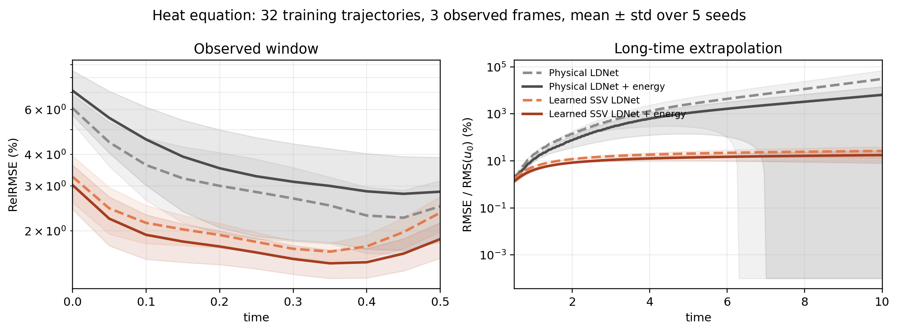

# SSV-GF-LDNet

Learning self-similar representations and local gradient-flow energies for
data-efficient, long-time PDE prediction.

The prototype studies a 1D heat equation on a large-domain approximation of
the real line. During training, the model receives initial fields and three
observed frames only. It is **not** given the PDE right-hand side, analytic
energy, Gaussian generation parameters, or the theoretical similarity
exponents.

## Model

The encoder-free shifted LDNet starts from `z_{-1}=0`. A learned initial-field
representation conditions the latent dynamics, and a continuous RBF decoder
returns the transformed field. For learned SSV models,

```text
xi = x / (1+t)^alpha
tau = log(1+t)
w  = (1+t)^beta u
```

The optional local energy network learns `e_psi(w, w_xi)` and regularizes

```text
w_tau - alpha * xi * w_xi - beta * w = -delta E_psi / delta w.
```

## Main comparison

- Physical LDNet
- Physical LDNet + learned energy
- Learned SSV LDNet
- Learned SSV LDNet + learned energy
- Hand-designed SSV oracle, with and without learned energy

All comparisons use nested training sets, a fixed validation/test split,
three observed times (`0`, `0.25`, `0.5`), and five matched seeds.



The left panel reports RelRMSE inside the observed time window. The right panel
uses `RMSE / RMS(u0)`, whose denominator remains fixed during extrapolation.

## Quick start

```bash
python -m venv .venv
source .venv/bin/activate
pip install -r requirements.txt
mkdir -p data
python scripts/generate_data.py --out data/single_gaussian_heat.npz
bash scripts/run_one.sh learned_ssv_energy 32 0 cuda:0
pytest -q
```

For a small CPU smoke reproduction:

```bash
DEVICE=cpu bash scripts/reproduce_small.sh
```

To reproduce the complete 150-run matrix sequentially on one GPU:

```bash
DEVICE=cuda:0 bash scripts/run_matrix.sh
```

The command is restart-safe because completed runs are skipped. The full matrix
is much more expensive than the smoke test. Multi-GPU users can schedule
`scripts/run_one.sh` over the grid in `configs/heat_loop.json`.

The full experiment grid is documented in `configs/heat_loop.json`. Generated
datasets, checkpoints, and raw outputs are intentionally excluded from Git.
Aggregated metrics are provided in `results/summary/aggregate.json`.

## Repository layout

```text
configs/          experiment matrix
figures/          paper-ready aggregate figures
results/summary/  compact numerical summaries
scripts/          data generation, training, and plotting
tests/            mathematical identity tests
```

## Scope

This repository currently provides a controlled heat-equation prototype. The
known PDE and analytic energy are used only for data generation and post-hoc
interpretation, never as training targets.

The reported benchmark uses the same expanding comparison window
`|x| <= 4.5 sqrt(1+t)` for every method. This exponent is not supplied to the
learned SSV transform, but the window itself is a shared benchmark geometry
prior. A full-domain ablation should accompany claims of completely unknown
scaling.
